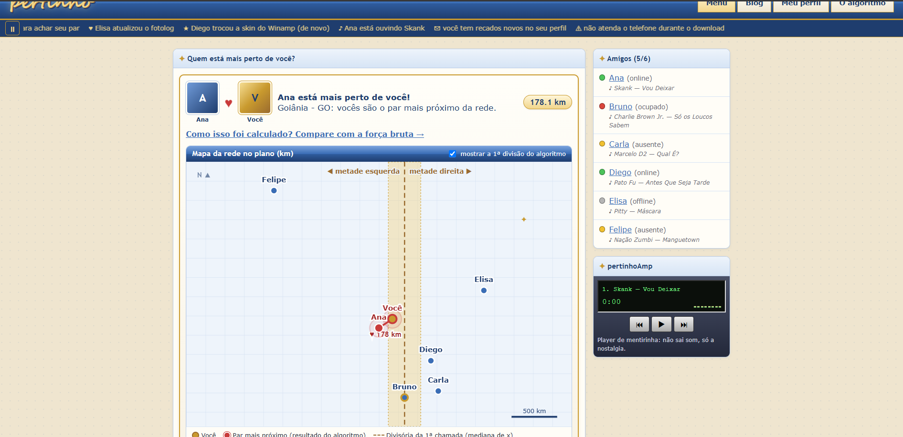
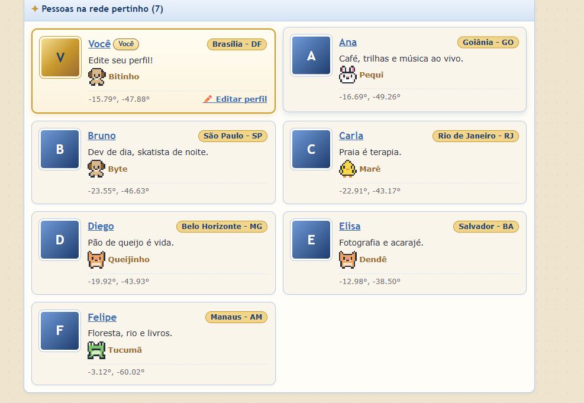
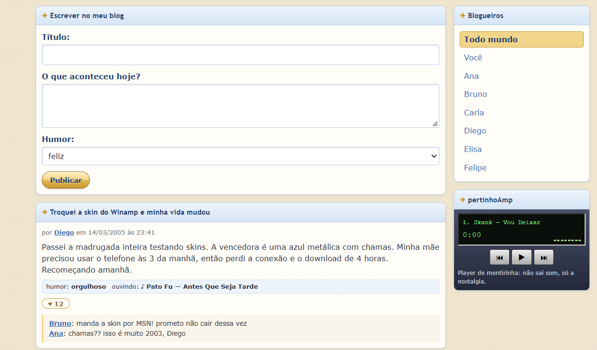
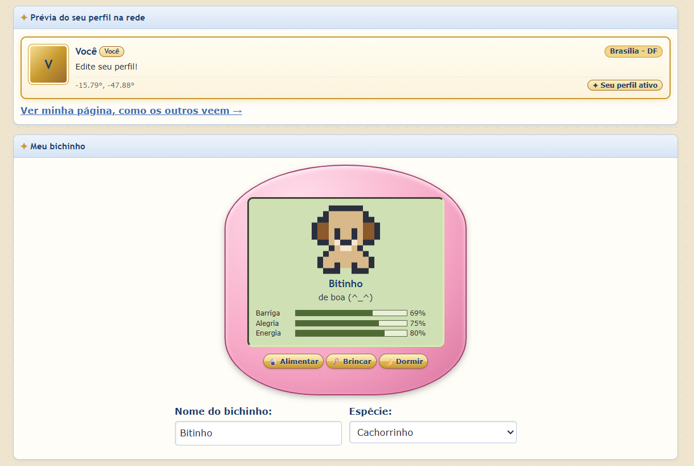

# Pertinho — Dividir e Conquistar

**Número da Lista**: G49<br>
**Conteúdo da Disciplina**: Dividir e Conquistar — Par de Pontos Mais Próximos<br>

## Alunos

| Matrícula | Aluno |
| -- | -- |
| 231011382 | Gabriel Sampaio (Pessoa A) |
| xx/xxxxxxx | Samuel (Pessoa B) |

## Sobre

**Pertinho** é uma micro rede social com cara de 2004 que roda inteira no navegador, sem servidor e sem internet. Ela tem cinco páginas:

- **Menu**: lista as pessoas da rede e responde *"Quem está mais perto de você?"*, num estilo parecido com o "match" de apps de encontro. Também tem lista de amigos no estilo mensageiro e um player de música de mentirinha.
- **Blog**: posts dos usuários com humor do dia, "ouvindo agora", curtidas e comentários. Você pode publicar os seus.
- **Meu perfil**: edita os seus dados (nome, bio e localização) e cuida do seu bichinho virtual, que sente fome, tédio e sono com o tempo.
- **Página de cada pessoa**: bichinho, recados, posts, amigos e a distância até você.
- **O algoritmo**: compara a força bruta e o dividir e conquistar em Big O e numa corrida ao vivo.

A rede tem **7 usuários**: você e mais 6 perfis fictícios em cidades diferentes do Brasil. Os dados ficam num "banco" local: um arquivo JSON inicial (`src/dados/usuarios.json`), com as edições salvas no `localStorage` do navegador. O conteúdo social (posts, recados, bichinhos, músicas) é todo mockado em `src/dados/social.ts`; só o que você adiciona fica salvo, e só neste navegador.

### O algoritmo

A localização de cada usuário (latitude/longitude) é convertida em um ponto no plano, em km, por uma projeção equiretangular (centrada na latitude de Brasília). Para as cidades do seed, a distância no plano difere da distância real (fórmula de haversine) em 0,8% em média e no máximo 4,5% (São Paulo–Rio), o que não muda o par mais próximo. Depois o algoritmo **Par de Pontos Mais Próximos** encontra, entre todos os usuários, as duas pessoas que estão mais perto uma da outra:

1. **Pré-processamento**: ordena os pontos por `x` e por `y`, uma única vez.
2. **Dividir**: separa os pontos em duas metades pela mediana de `x`.
3. **Conquistar**: resolve cada metade recursivamente e guarda a menor distância encontrada, `δ = min(δ_esq, δ_dir)`.
4. **Combinar**: um par mais próximo que `δ` só pode atravessar a divisória se os dois pontos estiverem na faixa de largura `2δ` em volta dela. Nessa faixa, ordenada por `y`, basta comparar cada ponto com **no máximo os 7 seguintes**.
5. **Caso base**: com 3 pontos ou menos, compara todos os pares.

A recorrência é `T(n) = 2T(n/2) + O(n)`, que dá **O(n log n)**, contra O(n²) da força bruta. A versão de força bruta (`src/algoritmo/forcaBruta.ts`) valida o resultado nos testes e aparece na página **O algoritmo**, que mostra a comparação em Big O, a contagem de distâncias calculadas e uma corrida cronometrada no seu navegador.

| n | Força bruta | Dividir e conquistar |
| -- | -- | -- |
| 1.000 | 28,5 ms | 1,1 ms |
| 5.000 | 767 ms | 9,6 ms |
| 10.000 | 6,2 s | 15,7 ms |
| 20.000 | 20,4 s | 59 ms |
| 50.000 | não medido | 186 ms |

Medido em um único computador, no Node 24, com pontos aleatórios: mediana de 3 execuções, exceto a força bruta com n ≥ 10.000, que rodou uma vez só. Os valores variam entre máquinas e execuções, então leia a tendência, e não os números exatos.

Se você faz parte do par mais próximo, o menu mostra quem é o seu "match". Se não fizer, mostra quem são os dois usuários mais próximos da rede. Ao mudar a sua cidade no perfil, o resultado é recalculado.

## Screenshots






## Instalação

**Linguagem**: TypeScript<br>
**Framework**: nenhum (HTML + CSS + TypeScript puro, com [Vite](https://vite.dev/) como servidor de desenvolvimento)<br>

Pré-requisito: [Node.js](https://nodejs.org/) 20 ou superior.

```bash
git clone https://github.com/projeto-de-algoritmos-2026/G49_Dividir_e_Conquistar_PA-26.2.git
cd G49_Dividir_e_Conquistar_PA-26.2
npm install
npm run dev
```

Depois, abra o endereço mostrado no terminal (por padrão, http://localhost:5173).

| Comando | O que faz |
| -- | -- |
| `npm run dev` | Sobe o servidor de desenvolvimento |
| `npm test` | Roda os testes do algoritmo (Vitest) |
| `npm run build` | Checa os tipos e gera a versão final em `dist/` |
| `npm run preview` | Serve a versão gerada pelo build |

## Uso

1. Abra o **Menu** para ver as pessoas da rede e quem está mais perto de você.
2. Vá em **Meu perfil**, troque a sua cidade e salve. O menu abre de novo e o algoritmo roda com a nova localização.
3. Ainda em **Meu perfil**, alimente seu bichinho. Clique no nome de alguém no menu para ver a página da pessoa e deixar um recado.
4. Em **O algoritmo**, clique em **Iniciar corrida** para comparar as duas versões no seu navegador.
5. No **Blog**, leia os posts, curta e publique o seu.

## Estrutura do projeto

```
├── index.html               # página de menu
├── perfil.html              # edição do perfil e bichinho
├── blog.html                # blog da rede
├── pessoa.html              # página pública de cada pessoa (?id=)
├── algoritmo.html           # comparação de complexidade
├── src/
│   ├── layout.ts            # estilo global, aba ativa, letreiro, rodapé e "resetar dados"
│   ├── html.ts              # escape de texto para HTML
│   ├── algoritmo/
│   │   ├── parMaisProximo.ts  # dividir e conquistar, O(n log n)
│   │   ├── forcaBruta.ts      # referência O(n²)
│   │   ├── comparacao.ts      # fórmulas e cronômetro da corrida
│   │   ├── match.ts           # liga o resultado do algoritmo aos usuários
│   │   └── geo.ts             # lat/lon -> plano (km) e distância
│   ├── componentes/
│   │   ├── bichinho.ts        # bichinho virtual interativo
│   │   ├── sprites.ts         # desenhos em pixel art (SVG)
│   │   └── widgets.ts         # lista de amigos e player
│   ├── dados/
│   │   ├── usuarios.json      # seed: você + 6 usuários fictícios
│   │   ├── banco.ts           # usuários no localStorage
│   │   ├── armazem.ts         # leitura e escrita genérica no localStorage
│   │   ├── bichinhos.ts       # regras e estado do bichinho
│   │   └── social.ts          # posts, recados e perfis mockados
│   ├── paginas/
│   │   ├── menu.ts
│   │   ├── perfil.ts
│   │   ├── blog.ts
│   │   ├── pessoa.ts
│   │   └── algoritmo.ts
│   ├── styles/global.css
│   └── tipos.ts
└── tests/
    ├── parMaisProximo.test.ts
    └── extras.test.ts
```

## Divisão de trabalho

São 5 tarefas por pessoa, cada uma com uma issue no GitHub. Os detalhes estão em [docs/DIVISAO_DE_TRABALHO.md](docs/DIVISAO_DE_TRABALHO.md).

| Pessoa A — Gabriel | Pessoa B — Samuel |
| -- | -- |
| ✅ [#1](https://github.com/projeto-de-algoritmos-2026/G49_Dividir_e_Conquistar_PA-26.2/issues/1) Modelagem dos dados e banco local | ✅ [#6](https://github.com/projeto-de-algoritmos-2026/G49_Dividir_e_Conquistar_PA-26.2/issues/6) Layout base e identidade visual |
| ✅ [#2](https://github.com/projeto-de-algoritmos-2026/G49_Dividir_e_Conquistar_PA-26.2/issues/2) Algoritmo par de pontos mais próximos | ✅ [#7](https://github.com/projeto-de-algoritmos-2026/G49_Dividir_e_Conquistar_PA-26.2/issues/7) Página de menu com os cards |
| ✅ [#3](https://github.com/projeto-de-algoritmos-2026/G49_Dividir_e_Conquistar_PA-26.2/issues/3) Força bruta + testes de validação | ✅ [#8](https://github.com/projeto-de-algoritmos-2026/G49_Dividir_e_Conquistar_PA-26.2/issues/8) Página de perfil com edição de localização |
| ✅ [#4](https://github.com/projeto-de-algoritmos-2026/G49_Dividir_e_Conquistar_PA-26.2/issues/4) Integração do algoritmo com a interface | [#9](https://github.com/projeto-de-algoritmos-2026/G49_Dividir_e_Conquistar_PA-26.2/issues/9) Card de match e visualização dos pontos |
| [#5](https://github.com/projeto-de-algoritmos-2026/G49_Dividir_e_Conquistar_PA-26.2/issues/5) Documentação final e vídeo | [#10](https://github.com/projeto-de-algoritmos-2026/G49_Dividir_e_Conquistar_PA-26.2/issues/10) Testes manuais, revisão e gravação |

## Vídeo do trabalho

https://youtu.be/KnFZGqIpzlQ

## Outros

- O projeto não usa nenhum serviço externo; tudo roda localmente no navegador.
- Para voltar aos dados iniciais, use o botão "resetar dados" (ou limpe o `localStorage` do site).
